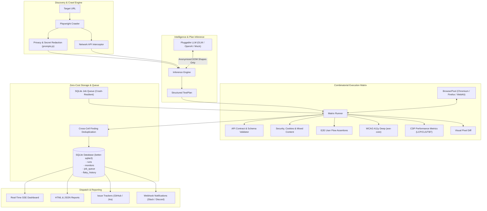

# TestFlow

> Autonomous software QA agent for web applications and APIs — crawls, infers test plans, executes matrix test suites across browsers, viewports, and auth roles, and files regressions to your issue tracker.

TestFlow is a zero-cost, self-hostable QA testing platform built on Node.js and Playwright. Give it any target web URL and TestFlow will autonomously crawl pages, inspect network waterfalls with automatic privacy redaction, generate test suites via an AI planner or deterministic heuristics, and run combinatorial tests across browsers (Chromium, Firefox, WebKit), responsive viewports, and authenticated roles. All runs, monitors, and job queues are persisted locally in SQLite with zero cloud dependencies.

---

## ⚡ 2-Minute Quickstart

### Prerequisites
- Node.js >= 20.0.0
- npm >= 9.0.0

### 1. Clone & Install
```bash
git clone https://github.com/your-username/testflow.git
cd testflow
npm install
npx playwright install --with-deps chromium
```

### 2. Start the Server & Dashboard
```bash
npm run start:dashboard
```
Open **[http://localhost:8080](http://localhost:8080)** in your browser.

### 3. Run Your First Scan
Trigger a headless scan against any public site directly from your terminal:
```bash
# Using curl
curl -X POST http://localhost:8080/api/runs \
  -H "Content-Type: application/json" \
  -d '{
    "url": "https://example.com",
    "options": {
      "maxPages": 3,
      "browsers": ["chromium"],
      "concurrency": 2
    }
  }'
```
Or open the dashboard UI at `http://localhost:8080`, type `https://example.com`, and click **Start Test**.

*(To test local dev sites on `localhost`, set `SQA_ALLOW_PRIVATE=true` in `.env`)*

---

## 🤖 Use TestFlow from Claude Code / Cursor

TestFlow exposes an official [Model Context Protocol (MCP)](https://modelcontextprotocol.io/) server running over standard input/output (`stdio`). This allows AI coding agents (Claude Code, Cursor, Codex, or any MCP-compatible client) to call TestFlow's accessibility, API contract, console error, and security checks directly inside their edit-test-fix loop.

### 1. Register the MCP Server

Add this configuration snippet to your `.mcp.json` (Claude Code) or Cursor MCP settings (`~/.cursor/mcp.json` or `.cursor/mcp.json`):

```json
{
  "mcpServers": {
    "testflow": {
      "command": "node",
      "args": ["src/mcp/stdio.js"],
      "env": {
        "SQA_ALLOW_PRIVATE": "true"
      }
    }
  }
}
```

> **Why `SQA_ALLOW_PRIVATE=true`?**
> TestFlow's enterprise SSRF boundary blocks private IP ranges (`127.0.0.1`, `10.0.0.0/8`, `192.168.0.0/16`, cloud metadata endpoints) by default. Setting `SQA_ALLOW_PRIVATE="true"` permits local loopback scanning so your agent can verify `http://localhost:3000` or local dev servers.

> **Security Note**: The `stdio` transport runs as a local subprocess with zero network exposure. If an HTTP/SSE transport is enabled for remote access in the future, token authentication becomes mandatory.

### 2. Available MCP Tools

| Tool | Purpose | Latency |
| :--- | :--- | :--- |
| `quick_check(url, scope?)` | Fast check (axe a11y + API contract + console/network errors) on a single page | ~1–5s |
| `check_accessibility(url)` | Focused WCAG a11y audit (axe-core) for markup & styling changes | ~1–3s |
| `check_api_contract(url, endpoints?)` | Probes REST endpoints for unexpected status codes or broken response schemas | ~100ms–2s |
| `explain_finding(rule_id)` | Plain-language explanation + recommended fix for any rule ID (e.g. `image-alt`) | Immediate |
| `start_full_scan(url, options?)` | Asynchronous deep matrix scan (crawls, multi-browser, viewports). Returns `job_id` | Immediate |
| `get_scan_status(job_id)` | Polls status (`pending` | `running` | `complete` | `failed`) and pages scanned | Immediate |
| `get_scan_report(job_id, verbosity?)` | Invariant-validated structured JSON report with CONFIRMED findings | Immediate |

### 3. Example Prompts for Your Coding Agent

Once connected, you can give your AI agent natural prompts like:

- **Pre-commit verification**:
  > *"Run a quick check against http://localhost:3000 before I commit this change."*
- **A11y regression check**:
  > *"I just refactored the checkout modal and form inputs. Run check_accessibility against http://localhost:3000/checkout and fix any violations."*
- **Investigate & repair**:
  > *"The quick check failed on rule `api-status-mismatch`. Call explain_finding to understand the requirement, find the route handler, and fix the mismatch."*
- **Deep matrix scan**:
  > *"Start a full scan on http://localhost:3000 with start_full_scan, poll get_scan_status until done, and summarize confirmed bugs."*

---

## 🐳 Self-Host with Docker (1 Command)

TestFlow runs on 100% free, official Docker base images with zero external services:

```bash
cp .env.example .env
docker compose up -d --build
```
Your dashboard is live on port `8080`, with SQLite database and screenshots persisted to `./data`.

---

## 🏛 Architecture



### Module Breakdown
- **`src/matrix/`**: Combinatorial execution engine testing $\text{Browsers} \times \text{Viewports} \times \text{Auth Roles}$. Deduplicates findings by `(ruleId, pageUrl)` and tracks non-deterministic flaky tests.
- **`src/storage/`**: Relational persistence via `better-sqlite3`. Includes ANSI SQL schema (`runs`, `monitors`, `job_queue`, `flaky_history`) designed for future zero-friction migration to PostgreSQL.
- **`src/services/jobQueue.js`**: Atomic SQLite-backed job queue. Guarantees in-flight and queued runs survive process crashes and restarts without Redis or BullMQ.
- **`src/explorer/`**: AI test planner. Generates E2E user flows and API schema expectations using anonymized DOM structure.
- **`src/services/ssrf.js`**: Enterprise SSRF protection. Blocks IPv4/IPv6 private subnets, link-local, unique-local, and DNS-rebinding attacks with TTL-based DNS caching.
- **`src/services/sessionStore.js`**: Encrypted "record-once login" store using AES-256-GCM. Allows authenticated scanning without saving user credentials in plain text.
- **`src/services/compliance.js`**: Maps axe-core accessibility audit rules directly to WCAG 2.x Level A/AA criteria.

---

## 🧭 Open Source Core vs. Hosted Cloud Seams

TestFlow is developed as an open-core architecture. Everything needed to test, crawl, plan, and monitor your web applications is 100% free and open source.

| Capability | Open-Source Engine (This Repo) | Future Hosted Cloud Tier |
| :--- | :---: | :---: |
| **Execution Engine** | Complete (All 7 executors + Matrix runner) | Cloud-managed browser grid |
| **Persistence** | Embedded SQLite (`better-sqlite3`) | Multi-tenant PostgreSQL (Supabase / RDS) |
| **Job Queue** | SQLite persistent queue (`job_queue` table) | Distributed worker cluster |
| **Issue Filing** | GitHub, Jira, Console | GitHub, Jira, GitLab, Linear, Asana |
| **Dashboard** | Lightweight local SSE dashboard | Multi-tenant team workspace |
| **Visual Testing** | Pixel-diff assertion engine | Interactive "Accept Baseline" approval UI |
| **Authentication** | Local AES-256 session vault | Enterprise SAML / Okta SSO |

> **Architectural Seam Note**: The database schema in `src/storage/db.js` uses standard ANSI SQL (`TEXT`, `REAL`, `INTEGER`, JSON columns) and avoids SQLite-specific quirks. When enabling the hosted tier, swapping the SQLite driver for a PostgreSQL pool requires zero changes to the core business logic.

---

## 🔒 Security & Privacy Guarantees

1. **AI Anonymization**: Session cookies, Bearer tokens, and user passwords **never touch the LLM**. Request bodies are filtered and only structural shapes (e.g. `{"id": "string"}`) are sent to inference models. Enforced in `src/explorer/prompts.js` and verified by `test/llmPrivacy.test.js`.
2. **Encrypted at Rest**: Recorded authenticated sessions are encrypted using **AES-256-GCM** with a persistent local key (`data/.session.key`) or your custom `SQA_SESSION_SECRET`.
3. **SSRF Hardened**: Crawls and HTTP probes are validated against public IP ranges. Internal subnet probing and localhost scanning are strictly blocked by default.

---

## 🧪 Testing

TestFlow has a comprehensive unit and integration test suite:

```bash
npm test
```
All **500+ tests** run via Node.js native test runner in ~11 seconds with zero external dependencies.

---

## 📜 License

Licensed under the **[Apache License, Version 2.0](LICENSE)**.
You may freely use, modify, distribute, and self-host TestFlow for personal or commercial projects.
